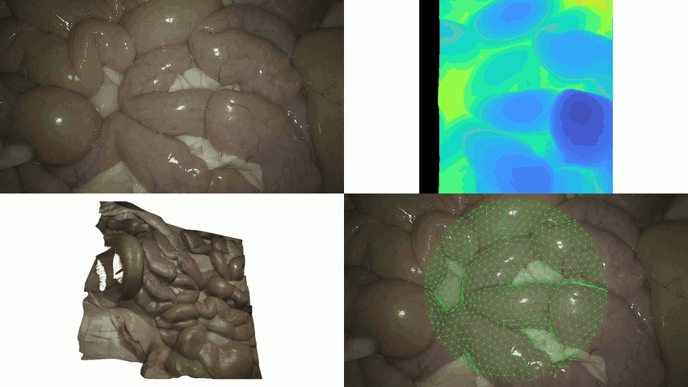
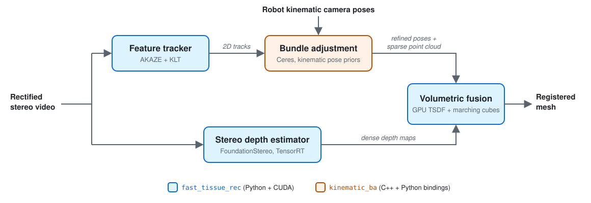

# A Fast Framework for Metric 3D Reconstructions and Vision-Based Tracking for Surgical Robotic Platforms

<p align="center">
  
</p>

Juan Antonio Barragan<sup>†1</sup>, Brendan Burkhart<sup>†2</sup>, Balazs Vagvolgyi<sup>†2</sup>, Roger D. Soberanis-Mukul<sup>2,3</sup>, Mathias Unberath<sup>1</sup>, Peter Kazanzides<sup>1</sup>, and Emad Boctor<sup>2</sup>

<sup>†</sup> Equal contribution

*Submitted to Healthcare Technology Letters*

## Overview

This repository hosts the code for a fast framework that gives surgical robotic platforms:

- **Metric 3D reconstruction** of the surgical scene using a Structure-from-Motion (SfM) pipeline.
- **Vision-based tracking** during surgery.

### Pipeline

<p align="center">
  
</p>

The pipeline receives recorded stereo video of the robot scanning a region of tissue, and produces a metric, registered PLY mesh of the scanned tissue. It consists of
 - a 2D feature tracking module based on the AKAZE feature detector and the Kanade-Lucas-Tomasi tracker,
 - a bundle adjustment module built on the Ceres optimizer, using the robot's kinematic camera poses as priors,
 - a stereo depth estimation module built on (Fast)FoundationStereo,
 - and a GPU-accelerated volumetric fusion module.


### Repository layout

The code is split into two pip-installable packages:

```
surgtrack3d/
├── src/
│   ├── kinematic_ba/      C++ bundle adjustment (Ceres) + pybind11 bindings  → see src/kinematic_ba/README.md
│   └── fast_tissue_rec/   Python pipeline: tracker, depth estimator, volumetric fusion, run_* scripts, visualization
├── scripts/               batch scripts for rectification and reconstruction
└── docs/                  pipeline diagram and Sphinx API docs (docs/api)
```

| Package | Language | Build requirements | Provides |
|---|---|---|---|
| [`kinematic_ba`](src/kinematic_ba) | C++20 + Python bindings | vcpkg (Ceres, Eigen, pybind11) | `kinematic_ba.slam` |
| [`fast_tissue_rec`](src/fast_tissue_rec) | Python + CUDA kernel | CUDA Toolkit, TensorRT | tracking, depth, fusion, `python -m fast_tissue_rec` |

`fast_tissue_rec` depends on `kinematic_ba`, so install `kinematic_ba` first.

## Installation

### Choosing what to install

The code is modular: install only what you need. `fast_tissue_rec` has a small CPU-only core plus optional extras, and the CUDA kernel is only compiled when a CUDA compiler is available.

| You want to run | Install | Needs |
|---|---|---|
| Rectification, feature tracking | `fast_tissue_rec` | nothing beyond Python |
| + bundle adjustment (`run_slam`) | `kinematic_ba` + `fast_tissue_rec[ba]` | vcpkg (C++ build) |
| + stereo depth estimation | `fast_tissue_rec[depth]` | CUDA 13.2, TensorRT engine |
| + volumetric fusion | `fast_tissue_rec[fusion]` | CUDA 13.2 (`nvcc`, compiles the TSDF kernel) |
| + visualization scripts | `fast_tissue_rec[viz]` | — |
| Reconstruction evaluation (registration + RMSE) | `fast_tissue_rec[eval]` | nothing beyond Python (no CUDA) |
| Full pipeline (`python -m fast_tissue_rec`) | `kinematic_ba` + `fast_tissue_rec[all]` | all of the above |

Extras can be combined, e.g. `fast_tissue_rec[depth,viz]`.

Exact tested versions are kept per package in `src/kinematic_ba/requirements.txt` and `src/fast_tissue_rec/requirements.txt` (the top-level `requirements.txt` includes both). Pass them with `-c` (constraints): pip then pins only the packages your chosen extras actually pull in.

### Dependencies

This code is built and tested on Ubuntu 24.04, with the system version of Python (3.12) and CUDA v13.2. Newer releases may work.

- **kinematic_ba** needs [vcpkg](https://vcpkg.io) with `VCPKG_ROOT` defined, plus a few system build tools. See [src/kinematic_ba/README.md](src/kinematic_ba/README.md) for the full build instructions.
- **fast_tissue_rec[depth]** and **[fusion]** need the CUDA Toolkit v13.2 (for `nvcc` and the CUDA runtime used by cupy/pycuda). TensorRT 11.1 is installed from pip; its version must match the one used to build the FoundationStereo engine (`trtexec` comes with a full TensorRT install, see below).
  - [CUDA Installation Guide](https://docs.nvidia.com/cuda/cuda-installation-guide-linux/index.html). Make sure you follow the "Post-installation actions" to update your environment variables.
  - [Installing TensorRT](https://docs.nvidia.com/deeplearning/tensorrt/latest/installing-tensorrt/installing.html). Note that downloading TensorRT unfortunately requires signing up for an NVidia developer account. For TensorRT, only the Debian or Tar installation methods will work easily - the Debian package route is the easiest, but only allows one version of CUDA/TensorRT to be installed. If you already have a conflicting version installed, use the Tar File method to install a different local version. For the Debian package method, on Step 5 make sure you choose the "Full C++ and Python Runtime" option.

#### (Fast) FoundationStereo

Only needed for `fast_tissue_rec[depth]`. We run FoundationStereo via TensorRT. For best performance, the TensorRT engine needs to be optimized for the specific GPU that inference will be run on. You will need to download `fast_foundationstereo.onnx` and `fast_foundationstereo.yaml` from the [PSI OneDrive](https://livejohnshopkins.sharepoint.com/:f:/s/ARPA-HPSI2/IgBLpH8TGMQVRrW2QIjId3vXAeG2d2X0vrdV76U3EqjziJQ?e=wAGVui), and place them in a models directory of your choice.

Run
```sh
trtexec --memPoolSize=workspace:24G --onnx=<models_dir>/fast_foundationstereo.onnx --saveEngine=<models_dir>/finetuned_foundation_stereo_32_iters.engine
```
in order to produce the optimized engine. This may take several minutes to run depending on your GPU.

The engine and YAML config are copied into the `fast_tissue_rec` package at build time, so `<models_dir>` must contain `finetuned_foundation_stereo_32_iters.engine` and `fast_foundationstereo.yaml` (these names are loaded by `fusion/depth_estimation.py`). Point the build at the folder with the CMake cache variable `MODELS_DIR`. If the files are not found, the package still installs, with a warning, and depth estimation is unavailable.

### Installing the packages

Create a virtual environment:
```sh
python3 -m venv .venv
source .venv/bin/activate
```

**Lightweight (CPU only, e.g. rectification and tracking):**
```sh
pip install ./src/fast_tissue_rec -c src/fast_tissue_rec/requirements.txt
```

**Evaluation only (no CUDA, works on macOS/Linux):**
```sh
pip install "./src/fast_tissue_rec[eval]" -c src/fast_tissue_rec/requirements.txt \
    -C cmake.define.FTR_BUILD_CUDA=OFF
```

**Full pipeline**, from the repository root:
```sh
pip install ./src/kinematic_ba -c src/kinematic_ba/requirements.txt
pip install "./src/fast_tissue_rec[all]" -c src/fast_tissue_rec/requirements.txt \
    -C cmake.define.MODELS_DIR=<models_dir>
```

Build options for `fast_tissue_rec` (pass with `-C cmake.define.<NAME>=<value>`):

| Option | Default | Meaning |
|---|---|---|
| `FTR_BUILD_CUDA` | `AUTO` | Build the TSDF CUDA kernel: `AUTO` (if `nvcc` is found), `ON` (required), `OFF` (skip) |
| `MODELS_DIR` | see `CMakeLists.txt` | Folder with the FoundationStereo engine and YAML config |
| `TSDF_CUDA_ARCHITECTURES` | `native` | GPU architecture for the TSDF kernel |

The TSDF CUDA kernel is compiled for the GPU in the machine (`native`). On a machine with **different GPU models**, this fails (`Option '--cubin' is not allowed when compiling for multiple GPU code instances`); pass the compute capability (with `-real`) of the GPU used at runtime (CUDA device 0) instead, e.g. `-C cmake.define.TSDF_CUDA_ARCHITECTURES=120-real` for an RTX 5090.

Both packages also support editable installs (`pip install -e <path> --no-build-isolation`); see [src/kinematic_ba/README.md](src/kinematic_ba/README.md#editable-install).

### Building documentation

You can also build Sphinx documentation for the Python modules. With both packages installed in your venv (plus the `[docs]` extra), run `make html` from `docs/api/`. This will generate the documentation at `docs/api/_build/html/index.html`, which can be opened in a browser.

## Usage

The following instructions are written assuming that you are inside a folder with a subfolder `./input_data` containing your camera calibration `calibration.json`, raw kinematic camera poses `ecm_poses.json`, and rectified stereo videos `left_rect.avi`, `right_rect.avi`. Adjust input/output arguments as necessary.

Also, for the individual steps/visualization, please run `export SCRIPTS=<absolute path to repository root>/src/fast_tissue_rec/fast_tissue_rec`. This just makes the following commands less verbose, but is not otherwise necessary.

### Running full reconstruction

To run the entire pipeline, use
```sh
python -m fast_tissue_rec -c ./input_data/calibration.json -l ./input_data/left_rect.avi -r ./input_data/right_rect.avi -p ./input_data/ecm_poses.json -o ./result/output_mesh.ply
```

### Running individual steps

Individual steps of the pipeline can be run one at a time for easier analysis and debugging.

0. Rectifying raw stereo video (only needs the lightweight install):
   ```sh
   python -m fast_tissue_rec.preprocessing.rectify_stereo_video --calibration input_data/calibration.json --left-video raw/left.mkv --right-video raw/right.mkv --output-dir input_data
   ```
   This writes `left_rect.mkv` and `right_rect.mkv` to `--output-dir` (or next to the inputs if omitted). The calibration must contain `rect_image_width`/`rect_image_height`. To rectify many clips, see `scripts/run_rectification.sh`.

1. Running feature tracking:
   ```sh
   python $SCRIPTS/run_tracking.py -l input_data/left_rect.mkv -r input_data/right_rect.mkv -p input_data/ecm_poses.json -o tracking_output
   ```
   This will produce a folder `tracking_output` containing 2D feature tracks in a sub-folder named `tracks`, subsampled stereo frames in `images/` indexed by `images/stereo_index.json`, and subsampled camera poses in `ecm_poses.json`.

2. Running SLAM
    ```sh
    python $SCRIPTS/run_slam.py -c ./input_data/calibration.json -p ./tracking_output/ecm_poses.json -f ./tracking_output/tracks/ --poses-output ./tracking_output/slam_poses.json --features-output ./tracking_output/features.csv
    ```
    This will produce a CSV file containing 3D feature positions, and a JSON file containing refined camera poses.

3. Running depth estimation
    ```sh
    python $SCRIPTS/run_depth_estimation.py -c ./input_data/calibration.json -s ./tracking_output/images/stereo_index.json --output-dir ./depth_maps/
    ```
    This will produce the depth maps saved in float32 TIFF format, as well as a JSON "index file" named "depth_map_index.json" in the output directory containing a list of paths to the depth maps. Note: most image viewers can't display 32-bit formats, see depth map visualization below instead.

4. Running volumetric fusion
    ```sh
    python $SCRIPTS/run_fusion.py -c ./input_data/calibration.json -s ./tracking_output/images/stereo_index.json -d ./depth_maps/depth_map_index.json -p ./tracking_output/slam_poses.json -f ./tracking_output/features.csv -o ./result/output_mesh.ply
    ```
    This will produce the final 3D reconstruction as a PLY mesh file.

### Visualization tools

- Visualizing 2D feature tracks compared to projections of 3D features (you must run the individual steps for both feature tracking and SLAM):
  ```sh
  python $SCRIPTS/visualization/visualize_features_2d.py -c ./input_data/calibration.json -f ./tracking_output/features.csv -p ./tracking_output/slam_poses.json -s ./tracking_output/images/stereo_index.json -t ./tracking_output/tracks -o ./features_visualization
  ```
- Visualizing 3D features (you must run the individual steps for both feature tracking and SLAM):
  ```sh
  python $SCRIPTS/visualization/visualize_features_3d.py -f ./tracking_output/features.csv -o features3d.ply
  ```
  The mesh file output `features3d.ply` can be opened in e.g. Meshlab (you may need to increase the point size to see the feature points), or another 3D viewer.
- Visualizing raw or SLAM camera trajectories:
  ```sh
  python $SCRIPTS/visualization/visualize_camera_trajectory.py -p ./tracking_output/<ecm_poses.json or slam_poses.json> -o camera_trajectory.ply 
  ```
  Again, mesh output can be viewed in Meshlab or other PLY viewer.
- Visualizing depth maps as 2D images:
  ```sh
  python $SCRIPTS/visualization/visualize_depth_maps.py -d ./depth_maps/depth_map_index.json -o ./depth_maps
  ```
- Visualizing depth maps as 3D point clouds:
  ```sh
  python $SCRIPTS/visualization/visualize_depth_clouds.py -d ./depth_maps/depth_map_index.json -s ./tracking_output/images/stereo_index.json -c ./input_data/calibration.json -p ./tracking_output/slam_poses.json -o ./depth_maps
  ```
  This will produce a separate PLY file for each frame, which can be viewed in Meshlab. Make sure to set the point shading to "None" to properly view the colors. The point clouds are registered in the world/robot frame, so you can easily view multiple of them simultaneously.

### Evaluation

Register each reconstruction to its ground-truth mesh (similarity transform, ground truth = target) and compute the source→target surface RMSE ± STD in mm, as reported in the paper:

```sh
python -m fast_tissue_rec.evaluation.run_evaluation \
    --recon_dir data_intermediate_outputs/reconstruction \
    --gt_dir dataset/ground_truth_meshes \
    --output_dir data_intermediate_outputs/results
```

This writes, per reconstruction, `<output_dir>/<name>/` (transform, aligned mesh, report, overlay/heatmap) and a summary `<output_dir>/reconstruction_metrics.csv`. The two steps can also be run on a single pair:

```sh
python -m fast_tissue_rec.evaluation.register_meshes --source rec.ply --target gt.obj --out_dir out --seed 47
python -m fast_tissue_rec.evaluation.reconstruction_metrics out/aligned_source.ply gt.obj
```

## Datasets

TBD

## Citation

TBD

## License

TBD
